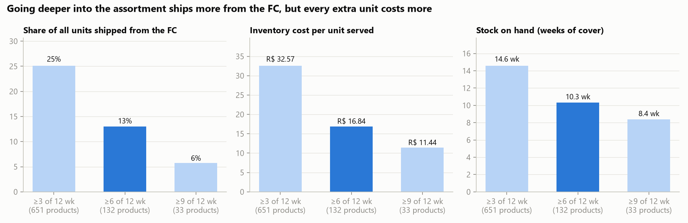
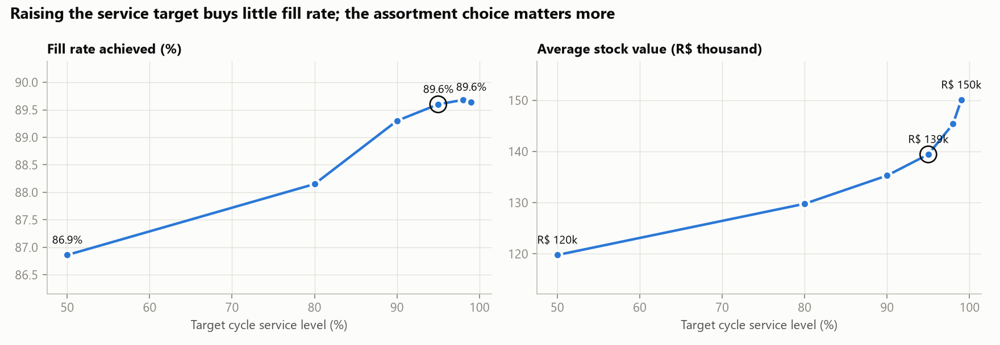
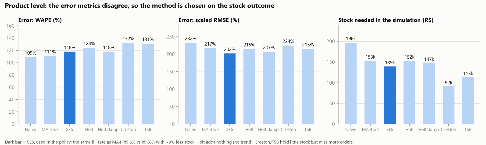
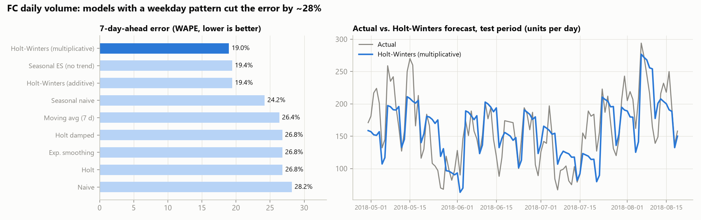

# What should the São Paulo FC stock, and how much? An inventory study

**Mini project 3 of 3 in a supply-chain portfolio.** It builds on [Project 1: Site selection](../site_selection/README.md), which placed the FC, and [Project 2: Vehicle routing](../vrp/README.md), which delivers from it.

**Interactive version: [site-selection-vrp.streamlit.app](https://site-selection-vrp.streamlit.app/inventory)**

**Tools:** SQL (SQLite) · Python (pandas, NumPy) · inventory simulation · matplotlib / Plotly

---

## 1. The business question

The São Paulo FC serves about 62% of Olist's orders. Olist is a marketplace with **~19,000 different products** sold to this area in one year, and **55% of products sell only once**. The FC cannot stock everything.

> Which products should the FC hold, how much of each, and when should it reorder, so that it ships as much as possible without tying up money in stock?

## 2. Recommendation (TL;DR)

| | Value |
|---|---|
| Products stocked | **~130**: those that sold in ≥6 of the last 12 weeks, re-planned every Monday |
| Share of São Paulo units shipped from the FC | **13%** (the rest is shipped by sellers, as today) |
| Fill rate on stocked products | **89.6%** |
| Average stock | **R$ 139k**, ~1,500 units, ~19 m³, 10 weeks of cover |
| Inventory cost | **R$ 129k / year = R$ 16.84 per unit served** |

- **Stock only the regular sellers.** Going deeper doubles the FC share but almost doubles the cost per unit (≥3 of 12 weeks: 25% share, R$ 32.57/unit).
- **Re-plan every week.** The assortment turns over fast: **52% of test-period units came from products with no sales in the previous 34 weeks.** A list fixed once ships 30% fewer units, and its stock ages.
- **Target 95%, not 99%.** Above 95% the fill rate stops improving while stock keeps growing.
- **Choose forecasts by their stock outcome.** Seven methods were compared per product, and nine for the FC's daily total. Exponential smoothing needs ~9% less stock than a moving average at the same fill rate. For daily volume, Holt-Winters (weekday season) cuts the error by ~28%.
- **The FC is a speed play, not a cost play.** At ~R$ 17 of inventory cost per unit (vs ~R$ 3 of freight saved, see project 1), it pays off through faster delivery, or through sellers paying fulfilment and storage fees.









### Analysis: what we chose and why
Every choice, including the stock rule, weekly re-planning, service level, order size, forecast method, lead time and how stockouts are treated, is listed with the alternatives and the reason in **[ANALYSIS.md](ANALYSIS.md)**. The same section appears on the website.

## 3. Method

```
clean tables ──► 01 SQL: SP FC demand ──► 02 ABC × demand pattern ──► 03 / 03b forecast backtests ──► 04 policy + simulation ──► 05 figures
```

1. **Demand** ([sql/01_fc_demand.sql](sql/01_fc_demand.sql)). Valid delivered order items from customers in zip zones served by the São Paulo FC (from project 1). Seller handling time is taken from the data.
2. **Segmentation** ([02_segment.py](02_segment.py)). ABC by revenue, plus the Syntetos-Boylan demand pattern based on how often a product sells and how much its quantities vary.
3. **Forecast backtests.**
   - **Per product, per week** ([03_forecast.py](03_forecast.py)): naive, 4-week moving average, exponential smoothing, Holt, damped Holt, Croston (SBA) and TSB, scored with WAPE, scaled RMSE and bias, then plugged into the stock simulation.
   - **FC total, per day** ([03b_forecast_daily.py](03b_forecast_daily.py)): seven non-seasonal methods vs Holt-Winters (additive and multiplicative, weekday season), 7-day-ahead rolling backtest.
4. **Policy + simulation** ([04_policy_simulation.py](04_policy_simulation.py)). Every Monday the plan is rebuilt from past data only:
   - **list:** products sold in ≥6 of the last 12 weeks;
   - **forecast:** exponential smoothing (SES);
   - **safety stock** = z × σ × √(lead time / 7);
   - **reorder point** = lead-time demand + safety stock;
   - **order quantity** = min(EOQ, 8 weeks of demand).

   Then the 16 test weeks are replayed day by day on real orders, after 4 warm-up weeks. Delisted stock is returned to the seller, and unserved demand is shipped by the seller.
5. **Trade-offs compared:** stock rule (3/6/9 of 12 weeks), service level (50–99%), order cap (4 weeks / 8 weeks / pure EOQ), and a fixed list vs. weekly re-planning. All are in `outputs/policy_tradeoff.csv`.

### Assumptions (illustrative, at the top of `04_policy_simulation.py`)

| | Value |
|---|---|
| Lead time | seller handling (data, median ≈ 2 days) + 2 days transit + 1 day receiving → median 6 days |
| Holding cost | 25% of product value per year |
| Replenishment order / removal order | R$ 40 each |
| Max order size | 8 weeks of forecast demand |

## 4. Limitations

- **The price paid by the customer** is used as the unit value. The real purchase cost would be lower, which would also lower the holding cost.
- **The FC has no capacity limit** in the model. At ~19 m³ of stock this is not a practical constraint.
- **Lead time is fixed per seller.** Variable lead times would need more safety stock.
- **Demand is the historical demand under direct shipping.** Faster delivery from the FC could itself increase sales of the stocked products.
- **Results move slightly** if the window dates change. The ranking of the options is stable.

## 5. How to run

Run this after the data pipeline and project 1 (it needs `olist.db` and the project 1 outputs):

```bash
.venv/Scripts/pip install -r inventory/requirements.txt
.venv/Scripts/python inventory/run_all.py          # about 3 minutes
```

## 6. What this project shows (PM lens)

- **Letting the data reframe the problem:** the fast-changing assortment turned "how much stock?" into "which products, and how often do we re-decide?".
- **Making trade-offs explicit:** assortment depth against cost per unit, and service level against capital.
- **Connecting the projects into one story:** where the FCs are (1), how they deliver (2), and what they hold (3). Each one shows the FC is about speed, which points to a fulfilment-fee business model.
