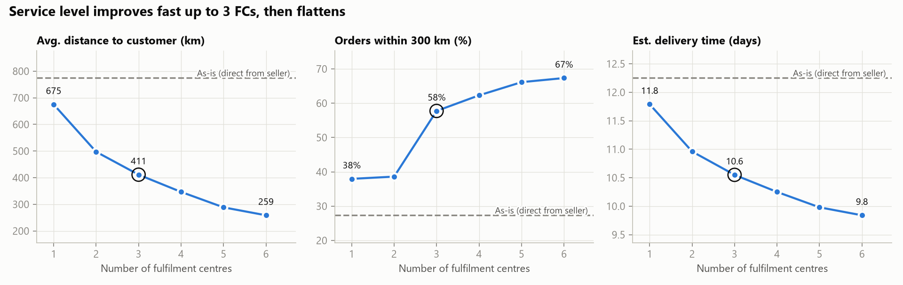
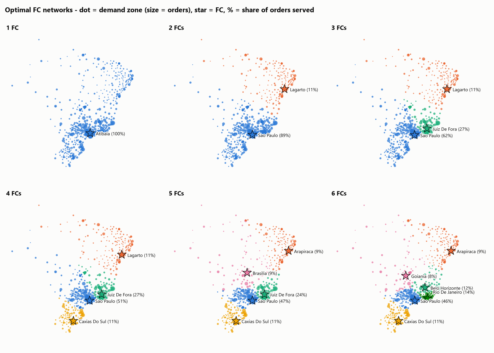
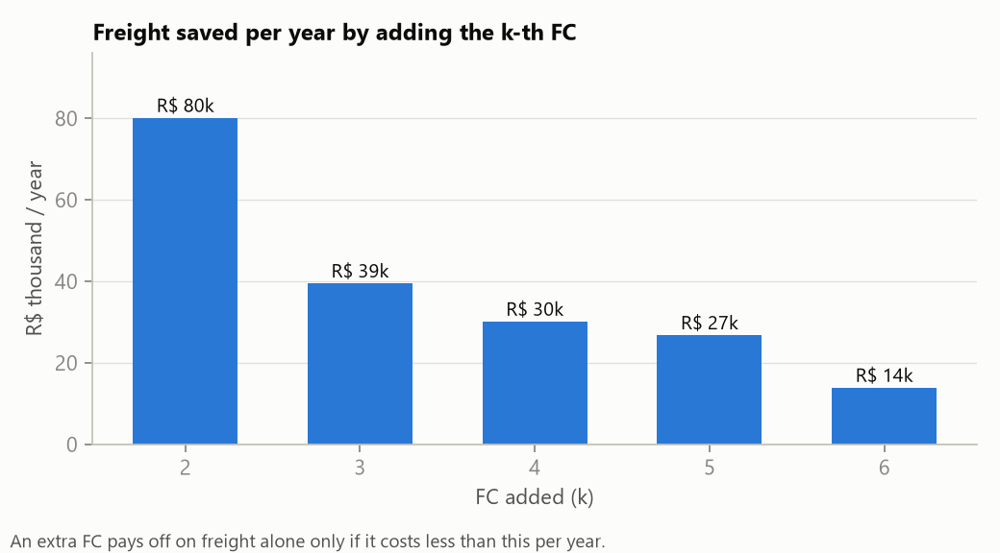

# Where should Olist open fulfilment centres? A site-selection study

**Mini project 1 of 3 in a supply-chain portfolio** (1. Site selection, 2. Vehicle routing, 3. Inventory management), built on the public [Olist Brazilian e-commerce dataset](https://www.kaggle.com/datasets/olistbr/brazilian-ecommerce) (~100k orders, 2016–2018).

**Tools:** Python data-cleaning pipeline · SQL (SQLite) for data modelling · Python (pandas, PuLP + HiGHS) for optimisation · matplotlib / folium for visuals

---

## 1. The business question

Olist is a marketplace: today **every seller ships directly to the customer**. 76% of items ship from São Paulo state, but only 42% of orders go there. So the typical parcel travels **~775 km** and takes **12.2 days**.

> If Olist moved to a fulfilment-centre (FC) model, **how many FCs should it open, and where?** What does each extra FC buy in service level and cost?

## 2. Recommendation (TL;DR)

| | As-is | **3 FCs (recommended)** | Change |
|---|---|---|---|
| Avg. distance to customer | 774 km | **411 km** | **−47%** |
| Orders within 300 km (~next-day reach) | 27% | **58%** | **+30 pp** |
| Orders within 800 km (~2-day reach) | 66% | **82%** | +15 pp |
| Est. delivery time | 12.2 days | **10.6 days** | −1.7 days |
| Est. freight per item | R$ 19.9 | **R$ 17.0** | −15% |

- **Start with 3 FCs: São Paulo, Minas Gerais/Rio corridor, and the Northeast.** This is the knee of the curve. The 3rd FC lifts next-day reach from 39% to 58%, the biggest single jump of any step.
- **The model's exact sites are not the final answer.** The optimiser picks Juiz de Fora (MG) and Lagarto (SE) because they sit at the centre of their demand. A **metro network (São Paulo + Rio + Salvador) is only 4% worse** on distance and has much better labour, real-estate and carrier access. That is the network I would take to stakeholders.
- **At today's volume, freight savings alone don't pay for an FC.** The 3rd FC saves about R$ 39k/year in freight. The case for FCs is **faster delivery and conversion**, or a volume-growth scenario, not freight cost. This is the main finding to put in front of decision-makers.
- **Phase 2 (4–5 FCs): add the South (Caxias do Sul / Porto Alegre) and the Centre-West (Brasília / Goiânia).** Beyond 5 FCs the curve is flat. The 6th FC adds no 800 km reach, because the model minimises average distance, not coverage.



## 3. Trade-off across 1–6 FCs

| FCs | Sites chosen by the model | Avg km | ≤300 km | ≤800 km | Est. days | Freight saved by this FC (R$/yr) |
|---|---|---|---|---|---|---|
| 1 | Atibaia-SP | 675 | 38% | 72% | 11.8 | – |
| 2 | São Paulo, Lagarto-SE | 497 | 39% | 78% | 11.0 | 80k |
| **3** | **São Paulo, Juiz de Fora-MG, Lagarto-SE** | **411** | **58%** | **82%** | **10.6** | **39k** |
| 4 | + Caxias do Sul-RS | 347 | 62% | 89% | 10.2 | 30k |
| 5 | São Paulo, Juiz de Fora, Caxias do Sul, Brasília-DF, Arapiraca-AL | 289 | 66% | 94% | 10.0 | 27k |
| 6 | São Paulo, Rio, Belo Horizonte, Caxias do Sul, Goiânia, Arapiraca | 259 | 67% | 94% | 9.8 | 14k |



An interactive version, where you can toggle k and hover zones and FCs, is in [`figures/network_map_interactive.html`](figures/network_map_interactive.html).

**Model optimum vs. practical metro networks (3 FCs)**

| Network | Avg km | ≤300 km | ≤800 km | vs. optimum |
|---|---|---|---|---|
| Optimal: São Paulo, Juiz de Fora, Lagarto | 411 | 58% | 82% | – |
| São Paulo + Rio + Salvador | 429 | 53% | 80% | +4.4% km |
| São Paulo + Belo Horizonte + Recife | 428 | 47% | 81% | +4.0% km |
| São Paulo + Rio + Recife | 430 | 53% | 79% | +4.5% km |



## 4. Method

```
archive/*.csv ──► data_pipeline (raw load + cleaning) ──► 01 SQL demand model ──► 02 p-median optimisation ──► 03 charts & map
```

1. **Data → clean database** ([../data_pipeline](../data_pipeline/README.md)). The 9 raw CSVs are loaded untouched into SQLite, then cleaned. Cleaning standardizes types, city names and zip codes, removes geo duplicates and points outside Brazil, flags inconsistent orders, imputes product dimensions, and runs validation checks. Every rule is logged in `cleaning_log.csv`. The CSVs stay the single source of truth.
2. **Demand model in SQL** ([sql/01_demand_model.sql](sql/01_demand_model.sql)):
   - **Fact table:** valid delivered order items (`is_valid_delivered = 1`), with customer and seller location, weight, price and freight.
   - **Demand zones:** customers are aggregated to 849 three-digit zip regions (order-weighted centroids). These cover ~100% of valid delivered orders (96,445 of 96,447).
   - **Candidate sites:** the top 3 demand zones in every state plus the top 60 nationally (119 candidates).
3. **Optimisation** ([02_optimize_sites.py](02_optimize_sites.py)). The **p-median** model opens exactly *k* sites and assigns each zone to one site, minimising order-weighted road distance. Haversine distance is multiplied by 1.3 to approximate road distance. The model is solved to proven optimality with HiGHS for k = 1…6 (849 × 119 ≈ 100k variables).
4. **Translating km into business KPIs.** Two regressions are fitted on the ~110k actual seller → customer shipments:
   - delivery days ≈ 8.6 + 0.47 × (km / 100), R² = 0.18 (shipments over 60 days excluded as outliers). Distance explains part of delivery time; seller handling and carrier choice explain the rest.
   - freight (R$) ≈ 8.2 + 0.82 × (km / 100) + 2.58 × kg, R² = 0.53.

## 5. Assumptions & limitations (what I'd validate next)

- **Outbound only.** Inbound replenishment (seller → FC) is not costed. Because 76% of supply is in São Paulo, a São Paulo FC has near-zero inbound cost, but Northeast FCs need line-haul. The next iteration should be a two-echelon model.
- **No fixed or operating FC costs.** These are not in the data, so the study reports the **break-even FC cost** (the marginal freight saving) instead of guessing rent and labour.
- **Regression-based KPIs** are directional (R² 0.18 for days). They are good for comparing scenarios, not for promising an SLA.
- **No capacity limits.** São Paulo would handle about 60% of volume. A capacitated model, or splitting São Paulo into two sites, is a natural extension.
- **Demand is historical (2017–18).** A growth scenario (e.g. 3× volume) would scale freight savings linearly and strengthen the FC case.

## 6. How to run

```bash
python -m venv .venv
.venv/Scripts/pip install -r site_selection/requirements.txt   # macOS/Linux: .venv/bin/pip
.venv/Scripts/python site_selection/run_all.py                 # cleaning + model, ~4 minutes
```

Outputs: `outputs/*.csv` (demand zones, candidates, chosen sites, zone assignments, scenario KPIs, practical variants) and `figures/`. The cleaning log is in `../data_pipeline/reports/`.

## 7. What this project shows (PM lens)

- **Framing a decision, not just a model:** "how many FCs, and where?", answered as a trade-off curve with a recommended starting point and a phase-2 path.
- **Data quality first:** a logged, validated cleaning layer that all three projects share.
- **Separating the optimum from what can be executed:** a 4% cost for real-world feasibility is an easy trade to explain to stakeholders.
- **Being honest about the business case:** at current volume the value is service level, not freight cost.
- **Setting up the next projects:** the chosen FCs become the depots for **Project 2 (VRP)** and the stocking points for **Project 3 (inventory)**.
