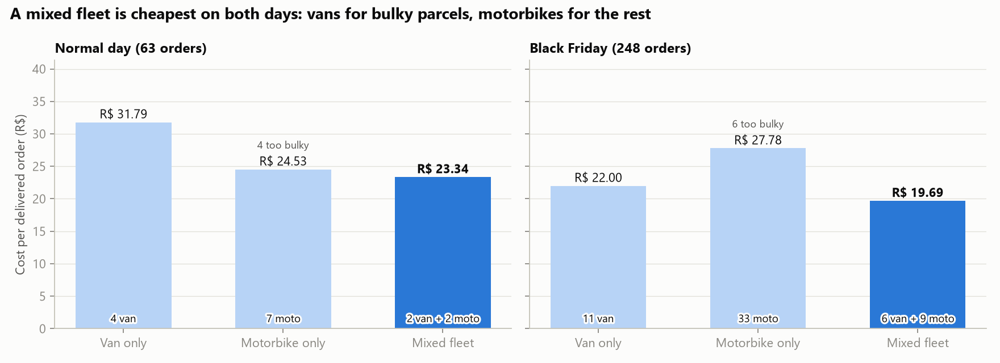
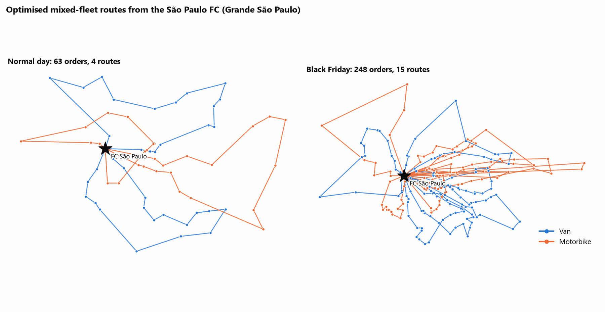

# How should the São Paulo FC deliver every day? A last-mile routing study

**Mini project 2 of 3 in a supply-chain portfolio.** It builds on [Project 1: Site selection](../site_selection/README.md), which placed a fulfilment centre (FC) in São Paulo.

**Interactive version: [site-selection-vrp.streamlit.app](https://site-selection-vrp.streamlit.app/vrp)**

**Tools:** SQL (SQLite) · Python · Google OR-Tools (vehicle routing) · matplotlib / Plotly

---

## 1. The business question

The FC is open. **Every morning it must deliver yesterday's orders to customers in Grande São Paulo.**

> How many vehicles do we need, which type (van or motorbike), what does each delivery cost, and what happens on a peak day?

The study compares two real days from the data:

| Day | Date | Orders (Grande SP) |
|---|---|---|
| Normal day | Thu 1 Mar 2018: the typical Tue–Thu in Mar–May 2018 | 63 |
| Peak day | **Black Friday, 24 Nov 2017**: the busiest day in the dataset | **248** (4×) |

## 2. Recommendation (TL;DR)

| | Normal day | Black Friday |
|---|---|---|
| Best fleet | **2 vans + 2 motorbikes** | **6 vans + 9 motorbikes** |
| Cost per order | **R$ 23.34** | **R$ 19.69** |
| Total distance | 480 km | 1,466 km |
| Saving vs a greedy "nearest next stop" plan | −28% | −38% |

- **Run a mixed fleet.** It is the cheapest option on both days. Vans take the bulky parcels, and motorbikes take the many small ones at about a third of the cost per km.
- **A motorbike-only fleet looks cheap but fails service.** 4 orders on a normal day (6 on Black Friday) are too bulky for a 90-litre motorbike box.
- **Van routes are limited by time, not space.** Vans run at only ~10% of their volume but use the full 9-hour shift. Adding stops per hour (denser areas, better time windows) matters more than adding capacity.
- **Peaks need a plan.** With only the normal-day fleet, **130 of 248 Black Friday orders (52%) slip to the next day**. Capacity has to roughly quadruple for one day, which is a case for on-demand or crowd-sourced riders rather than owning the fleet.
- **Density makes delivery cheaper.** With 4× the orders, cost per order *falls* (R$ 23.34 → R$ 19.69), because stops are closer together. Volume growth improves last-mile economics, which supports the FC strategy from project 1.





## 3. All scenarios

| Scenario | Vans | Motos | Km | Cost (R$) | R$/order | Not delivered |
|---|---|---|---|---|---|---|
| Normal: van only | 4 | 0 | 439 | 2,003 | 31.79 | 0 |
| Normal: motorbike only | 0 | 7 | 535 | 1,447 | 24.53 | 4 (too bulky) |
| **Normal: mixed** | **2** | **2** | **480** | **1,470** | **23.34** | **0** |
| Black Friday: van only | 11 | 0 | 1,160 | 5,456 | 22.00 | 0 |
| Black Friday: motorbike only | 0 | 33 | 2,236 | 6,722 | 27.78 | 6 (too bulky) |
| **Black Friday: mixed** | **6** | **9** | **1,466** | **4,882** | **19.69** | **0** |
| Black Friday: normal-day fleet only | 2 | 2 | 397 | 1,380 | – | **130** |

## 4. Method

```
clean tables ──► 01 SQL: delivery orders per day ──► 02 OR-Tools routing (7 scenarios) ──► 03 figures
```

1. **Orders** ([sql/01_delivery_orders.sql](sql/01_delivery_orders.sql)). Valid delivered orders from the [clean data layer](../data_pipeline/README.md) for customers in Grande São Paulo (zip codes 01000–09999). Each order has a location (zip centroid), weight and volume (summed from the product dimensions).
2. **Routing model** ([02_solve_vrp.py](02_solve_vrp.py)). This is a **capacitated vehicle routing problem with a shift limit, on a heterogeneous fleet**:
   - every order is visited exactly once, by a vehicle that can carry it;
   - each vehicle starts and ends at the FC, respects its weight and volume capacity, and returns within 9 hours;
   - the objective is to minimise total cost, i.e. fixed cost per vehicle used plus cost per km;
   - it is solved with **Google OR-Tools** (guided local search, 20 s for a normal day and 60 s for Black Friday). The mixed-fleet search starts from the van-only plan, so it can only match or beat it.
3. **Baseline.** The same model is solved with only a greedy "drive to the nearest next stop" heuristic, which is how a simple dispatcher plans. The savings are measured against this baseline.
4. **Fleet stress test.** For Black Friday with only the normal-day vehicles (2 vans + 2 motorbikes), every order may be dropped at a high penalty, so the solver delivers as many orders as possible.

### Operating assumptions (illustrative, editable at the top of `02_solve_vrp.py`)

| | Van (Fiorino-type) | Motorbike |
|---|---|---|
| Capacity | 650 kg / 3,300 L | 20 kg / 90 L box |
| Average speed in the city | 22 km/h | 30 km/h |
| Time per stop | 10 min | 5 min |
| Cost per km | R$ 1.10 | R$ 0.35 |
| Cost per vehicle-day (driver + vehicle) | R$ 380 | R$ 180 |

Shift: 9 hours, FC to FC. Orders bought on day D are delivered on day D+1 from FC stock.

## 5. Limitations

- **Distances** are straight-line × 1.3 (the same factor as project 1), not a real road network, and traffic is ignored.
- **Location** is zip-code level. Several orders can share one point, so the real number of stops is slightly higher.
- **No delivery time windows.** Adding customer windows would raise costs, especially for vans.
- **Costs and capacities are assumptions,** not Olist figures. Conclusions are about relative differences between scenarios.
- **Results vary slightly between runs** (by about ±1–2%), because the solver stops at a time limit. The ranking of the fleets is stable.

## 6. How to run

Run this after the data pipeline and project 1 (it needs `olist.db` and `site_selection/outputs/selected_sites.csv`):

```bash
.venv/Scripts/pip install -r vrp/requirements.txt
.venv/Scripts/python vrp/run_all.py          # about 7 minutes
```

## 7. What this project shows (PM lens)

- **Turning a network decision into daily operations:** the FC from project 1 becomes the depot here.
- **Showing trade-offs, not a single answer:** fleet mix against cost against service, and the normal day against the peak.
- **Finding the real constraint:** time, not capacity, limits vans, which shifts the focus to stop density and time windows.
- **Making peaks a planning problem:** quantifying the Black Friday gap (52% of orders late) turns "it's busy" into a concrete capacity requirement.
